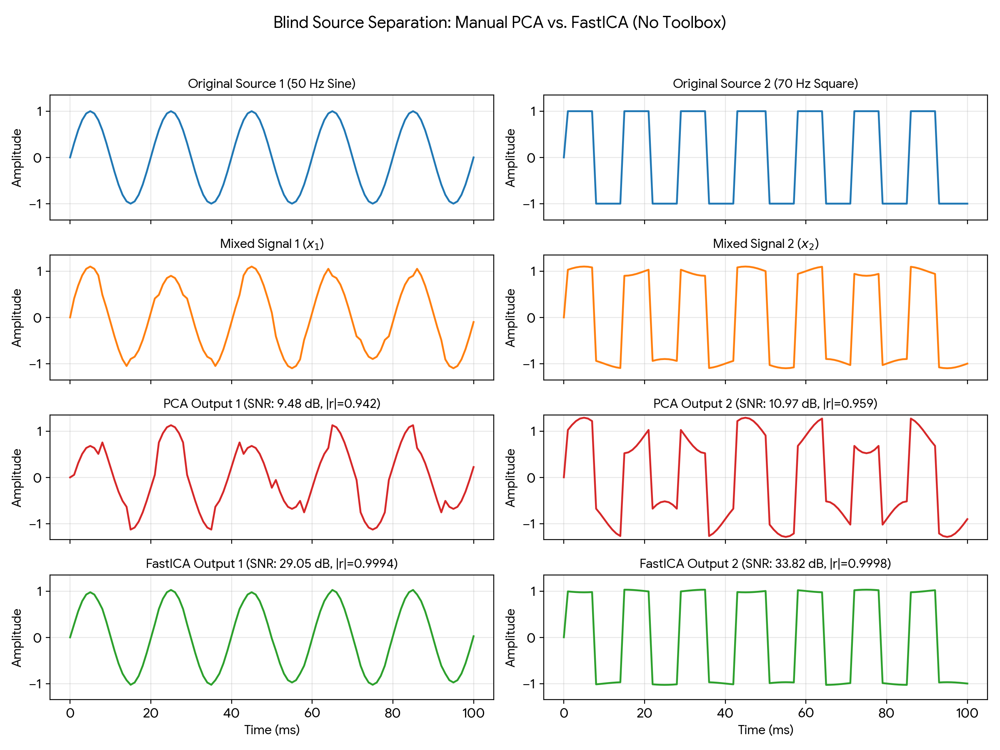

# Blind Source Separation (BSS) using PCA & FastICA in MATLAB

A toolbox-free **MATLAB** implementation and quantitative comparison of **Principal Component Analysis (PCA)** and **Independent Component Analysis (FastICA)** for separating linearly mixed signals.

Developed as part of the **Signals and Systems** course project at the Department of Electrical Engineering, Sharif University of Technology.



## Overview
Blind Source Separation aims to recover unknown underlying source signals $\mathbf{S}$ from linear mixtures $\mathbf{X} = \mathbf{H}\mathbf{S}$ without prior knowledge of either the sources or the mixing matrix $\mathbf{H}$.

In this project:
1. **Synthetic Source Generation:** Two statistically independent signals sampled at $f_s = 1000\text{ Hz}$ over $2\text{ s}$:
   - Source 1: $50\text{ Hz}$ sine wave
   - Source 2: $70\text{ Hz}$ square wave
2. **Linear Mixing:** Mixed via $\mathbf{H} = \begin{bmatrix} 1.0 & 0.1 \\ 0.1 & 1.0 \end{bmatrix}$.
3. **Manual PCA (Zero Toolbox):** Mean-centering, empirical covariance estimation, eigendecomposition (`eig`), descending eigenvalue sorting, and orthogonal projection.
4. **Manual FastICA (Zero Toolbox):** Spatial whitening ($\mathbf{Z} = \mathbf{D}^{-1/2}\mathbf{E}^\top \mathbf{X}_{\text{centered}}$) followed by fixed-point FastICA with contrast nonlinearity $g(u) = \tanh(u)$ ($g'(u) = 1 - \tanh^2(u)$) and symmetric orthogonalization $\mathbf{W} \leftarrow (\mathbf{W}\mathbf{W}^\top)^{-1/2}\mathbf{W}$.
5. **Evaluation:** Scale- and permutation-aligned Signal-to-Noise Ratio (SNR in dB) and absolute Pearson correlation $|r|$ against the ground-truth sources.

## Results

| Method | Source 1 SNR (50 Hz Sine) | Source 1 $|r|$ | Source 2 SNR (70 Hz Square) | Source 2 $|r|$ | Mean SNR |
| :--- | :---: | :---: | :---: | :---: | :---: |
| **PCA** | 9.48 dB | 0.9420 | 10.97 dB | 0.9592 | **10.22 dB** |
| **FastICA** | 29.05 dB | 0.9994 | 33.82 dB | 0.9998 | **31.44 dB** |

* **Key Takeaway:** Because PCA only enforces second-order decorrelation (orthogonality), it leaves residual cross-talk between the mixed signals (10.22 dB mean SNR). By exploiting higher-order statistical independence via non-Gaussianity maximization, FastICA converges in 4 iterations and achieves **31.44 dB** mean SNR (**+21.21 dB** improvement over PCA) with near-unity correlation ($|r| > 0.999$).

## Project Structure
```text
Blind-Source-Separation-PCA-ICA/
├── bss_pca_ica.m              # Complete toolbox-free MATLAB implementation
├── results/
│   └── bss_comparison.png     # Waveform comparison plot (0–100 ms window)
├── .gitignore
└── README.md
```

## How to Run
Requires **MATLAB** (no additional toolboxes required) or **GNU Octave**:
```matlab
run('bss_pca_ica.m')
```
